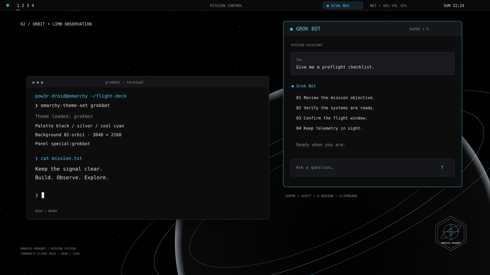

# Grokbot for Omarchy

A standalone Omarchy community theme with a black, silver, and cyan flight-deck aesthetic, nine rotating 4K wallpapers, and optional Grok Bot desktop integration. Theme files live at the repository root; `grokbot/` contains the scratchpad, Waybar module, launcher, and notification rules.

Community theme, not affiliated with or endorsed by xAI, SpaceX, or Omarchy.



`preview.png` is a 1920×1080 screenshot-style mockup, composed in `preview.svg`, not a captured desktop. `mark.svg` and its 1024×1024 `mark.png` render are an original mission badge. `backgrounds/` contains nine 3840×2160 JPEG wallpapers that rotate with Omarchy's background switcher: eight images generated with Grok Imagine and one SpaceX launch photo.

## Install

```bash
omarchy theme install https://github.com/pow3r-droid/omarchy-grokbot-theme
```

For a manual copy, run from this checkout (the destination must not already exist):

```bash
mkdir -p ~/.config/omarchy/themes
bin/omarchi-grokbot install --yes
omarchy-theme-set grokbot
```

The helper copies the repository payload to `~/.config/omarchy/themes/grokbot`, excluding hidden repository metadata. To copy without the helper:

```bash
mkdir ~/.config/omarchy/themes/grokbot
tar --exclude='./.*' -cf - . | tar -C ~/.config/omarchy/themes/grokbot -xf -
omarchy-theme-set grokbot
```

## Omarchy 4 (current) — native integration

Tested against Omarchy 4.0.4 / Hyprland 0.56 (Lua config). Omarchy 4 ignores `hyprland.lua` (and other Lua/terminal configs) in themes installed from a git repo, so after `omarchy theme install` and selecting **grokbot**, add this **one line** at the end of `~/.config/hypr/hyprland.lua` (back it up first), then run `hyprctl reload`:

```lua
pcall(dofile, os.getenv("HOME") .. "/.local/state/omarchy/current/theme/grokbot/hyprland/grokbot.lua")
```

(For a manual local copy, the theme's own `hyprland.lua` loads it automatically.)

- **Super+G** toggles the Grok Bot panel (`special:grokbot`). Windows of class `grok-bot` float, centered, at 80%×70%. This replaces Omarchy's default *Toggle window grouping* on Super+G.
- **Super+Shift+G** copies a region screenshot to the clipboard (`grim` + `slurp` + `wl-copy`). This replaces Omarchy's default *Signal* launcher on Super+Shift+G.
- Different window class: set `GROKBOT_CLASS` in your Hyprland environment. Disable the integration with `GROKBOT_DISABLE=1`.
- Launcher: `install -Dm644 ~/.local/state/omarchy/current/theme/grokbot/walker/grokbot.desktop ~/.local/share/applications/grokbot.desktop` (skip it if the Grok Bot app already has a launcher entry)
- Keep it current: `omarchy theme update`.

**Bar widget:** Omarchy 4 replaced Waybar with `omarchy-shell`, and its bar only takes widgets as separate plugins, not from themes. Install the companion plugin [omarchy-grokbot-plugin](https://github.com/pow3r-droid/omarchy-grokbot-plugin) with `omarchy plugin add https://github.com/pow3r-droid/omarchy-grokbot-plugin --enable`. The `grokbot/waybar/` files apply to Omarchy 3 only.

## Omarchy 3 (legacy)

### Grok Bot panel

**Super+G** toggles the dropdown scratchpad panel. Launch the app once through Waybar or Walker; the toggle does not launch it. Run `bin/omarchi-grokbot doctor` with the app open, then set `$grokbot_class` in the installed `grokbot/hyprland/scratchpad.conf` to its exact window class (escape regex punctuation).

**Super+Shift+G** selects a screenshot region and copies a PNG to the clipboard using `grim`, `slurp`, and `wl-copy`. Cancellation or missing tools is a graceful no-op. Check for existing binding conflicts.

The Waybar Grok Bot module opens an installed `grokbot` executable, or falls back to `https://grok.com/`. Right-click toggles the panel. Its status indicates executable availability. There are no API calls, credentials, or background services.

## theme-loaded vs one-line include

The exact legacy paths below target Omarchy 3's `~/.config/omarchy/current/theme`. Existing stock includes must not be duplicated. Optional module/launcher registration is distinct from the app's theme colors. A theme directory alone cannot register a Waybar module or a desktop launcher.

| Component | theme-loaded vs one-line include | Exact line / action |
| --- | --- | --- |
| Hyprland borders + scratchpad | Theme-loaded on the verified v3 conf layout | Existing `~/.config/hypr/hyprland.conf`: `source = ~/.config/omarchy/current/theme/hyprland.conf` |
| Scratchpad when templates replace `hyprland.conf` | One-line include, **only if** theme scratchpad source was removed by generation | Add to `~/.config/hypr/bindings.conf`: `source = ~/.config/omarchy/current/theme/grokbot/hyprland/scratchpad.conf` |
| Waybar palette | Theme-loaded via stock stylesheet import (verified v3.3) | Existing `~/.config/waybar/style.css`: `@import "../omarchy/current/theme/waybar.css";` |
| Waybar module definition | One-line include inside the root JSONC object | `"include": ["~/.config/omarchy/current/theme/grokbot/waybar/config-snippet.jsonc"],` (merge with existing includes) |
| Waybar module placement | Manual array entry | Add `"custom/grokbot"` to the existing `"modules-right"` array; it is not inserted automatically |
| Waybar module CSS | One-line stylesheet include | `@import "../omarchy/current/theme/grokbot/waybar/style-snippet.css";` at the top of `~/.config/waybar/style.css` |
| Walker colors | Legacy theme stylesheet; verify your Walker theme layout | `@import "../../../omarchy/current/theme/walker.css";` in `~/.config/walker/themes/omarchy/style.css` (relative path matches that location) |
| Walker launcher | Desktop entry registration, **no Walker include directive** | `install -Dm644 ~/.config/omarchy/current/theme/grokbot/walker/grokbot.desktop ~/.local/share/applications/grokbot.desktop` |
| Mako palette + app rules | One-line include if your config does not already load the theme | `include=~/.config/omarchy/current/theme/mako.ini` in `~/.config/mako/config`; `mako.ini` includes the bundled rules |
| Mako rules alone | One-line include if palette is generated and its bundled include was removed | `include=~/.config/omarchy/current/theme/grokbot/mako/rules.ini` in `~/.config/mako/config` |
| Hyprlock palette variables | Theme include in legacy installations; inspect existing config | `source = ~/.config/omarchy/current/theme/hyprlock.conf` in `~/.config/hypr/hyprlock.conf` |
| Alacritty | Legacy app import; inspect existing config | `general.import = ["~/.config/omarchy/current/theme/alacritty.toml"]` in `~/.config/alacritty/alacritty.toml` (merge imports; use the existing `[general]` table if present) |
| Ghostty | App config include | `config-file = ~/.config/omarchy/current/theme/ghostty.conf` in `~/.config/ghostty/config` |
| Kitty | App config include | `include ~/.config/omarchy/current/theme/kitty.conf` in `~/.config/kitty/kitty.conf` |
| btop / Neovim / icons / Chromium / SwayOSD / Foot | Omarchy theme consumers or app-specific config, depending on release | Select the theme using `omarchy-theme-set grokbot`; do not blindly source these files as shell code |

Walker indexes XDG desktop entries; reload its application provider if needed. The entry uses a generic installed system icon, while the mission badge remains within the theme. Mako matches notification `app-name=grokbot`; edit the installed rules if your app sends a different name. Include either the full Mako palette or the rules-only file, avoiding duplicate rules. The browser fallback is not assigned to the scratchpad unless you explicitly configure a browser class (which also affects other windows of that class).

## Compatibility

The supplied Hyprland scratchpad uses legacy `.conf` / `windowrulev2` syntax. The integration paths above target `~/.config/omarchy/current/theme`. On installations using `~/.local/state/omarchy/current/theme`, update every runtime reference, including scripts, desktop entries, nested includes, and relative CSS imports. Lua-based Hyprland configurations require adapted rules. Theme template generation may replace app configs; use the separate scratchpad include if it removes the bundled source line. Live integration on every Omarchy release is not verified.

## Optional helper

```bash
bin/omarchi-grokbot install         # dry-run
bin/omarchi-grokbot install --yes   # copy; refuses existing destination
bin/omarchi-grokbot doctor          # read-only dependencies and window classes
bin/omarchi-grokbot uninstall       # dry-run
bin/omarchi-grokbot uninstall --yes # remove installed grokbot folder
```

The helper never selects a theme or edits desktop configs. Before uninstalling, select another theme and remove optional includes and launcher registration.

## Assets and validation

With `rsvg-convert` installed, `python3 tools/build_assets.py` rebuilds the original wallpaper SVGs and renders all wallpapers, the badge, and the preview. The delivered badge and preview were rendered directly through installed librsvg because this build environment lacks `rsvg-convert` and cannot download packages. The rebuild command uses `rsvg-convert` as requested. Run `bash tests/run.sh` for asset integrity, config parsing, shell checks, isolated install/uninstall, launcher fallbacks, screenshot cancellation, and doctor checks. Live desktop behavior requires an Omarchy session.

## Community listing

For a community theme listing, use the repository URL, `preview.png` as the preview, and `mark.png` as the badge. Describe it as an independent community project; listing submission is separate from packaging this repository.

Licensed under MIT; see [LICENSE](LICENSE). Release history: [CHANGELOG.md](CHANGELOG.md).


## Wallpaper credits

- `01`–`08`: generated with Grok Imagine by the theme author.
- `09-spacex-launch.jpg`: photo by [SpaceX on Unsplash](https://unsplash.com/photos/rocket-launch-trail-in-night-sky-6SbFGnQTE8s), used under the [Unsplash License](https://unsplash.com/license). Its use here does not imply endorsement by SpaceX.
